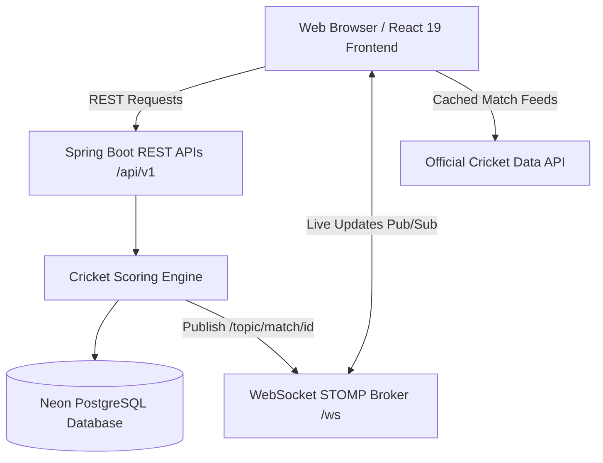

# 🏏 CRICSTASH — Real-Time Cricket Score Management & Match Centre


**CricStash** is an enterprise-grade, high-concurrency Cricket Score Management Platform engineered to handle real-time ball-by-ball scoring, live match streaming, comprehensive scorecards, and player career analytics. It combines a robust Spring Boot backend with a minimalist high-contrast White & Cricket Red React + TypeScript frontend, unified with real-time international cricket feeds from the CricAPI.

---

## 🌟 Key Features

### 🔴 Real-Time Match Engine & Scoring
- **Sub-Second Live Updates**: STOMP over WebSocket push notifications (`/topic/match/{matchId}`) broadcast every legal ball, boundary, wicket, and milestone instantly to all connected viewers.
- **Precision Scoring Engine**: Enforces MCC cricket laws including over transitions, strike rotations, extra calculations (wides, no-balls, byes, leg-byes, penalty runs), and all 10 dismissal modes.
- **Live Match Centre**: Features pitch trajectory visualization, crease striker indicator (`*`), current bowler figures, recent balls ribbon (`[4] [1] [•] [W] [6]`), and ball-by-ball commentary stream.
- **Full Digital Scorecards**: Detailed breakdown of batting (Runs, Balls, 4s, 6s, SR, Dismissal notes), bowling (Overs, Maidens, Runs, Wickets, Economy), extras, and fall of wickets.

### 🌐 Official CricAPI Integration
- **Live International & Domestic Fixtures**: Fetches ongoing international and league matches with team logos, venues, and live match state.
- **Upcoming Fixture Schedules**: Tracks scheduled matches with countdowns and ground information.
- **Smart Quota Caching**: Implements intelligent client-side session caching with 5–10 minute TTL to preserve API quota strictly within free-tier limits without sacrificing real-time feel.

### 🛡️ Enterprise Security & Access Control
- **Stateless JWT Authentication**: Secure HMAC-SHA256 tokens with role-based authorization:
  - `ROLE_ADMIN`: Match scheduling, team/player management, ground configs.
  - `ROLE_SCORER`: Live ball entry, toss record, innings initialization, and delivery corrections.
  - `ROLE_VIEWER`: Public live score consumption and match exploration.

---

## 🏗️ System Architecture



---

## 🛠️ Technology Stack

| Domain | Technology |
|---|---|
| **Backend Framework** | Java 21, Spring Boot 3.3.4 |
| **Persistence & ORM** | Spring Data JPA, Hibernate, Flyway Database Migrations |
| **Database** | Neon Serverless PostgreSQL |
| **Real-time Messaging** | Spring WebSocket, STOMP Protocol, SockJS fallback |
| **Security** | Spring Security 6, JWT (JSON Web Tokens) |
| **API Documentation** | OpenAPI 3.0, Swagger UI |
| **Frontend Framework** | React 19, TypeScript, Vite |
| **Styling & UI** | Tailwind CSS (CDN), Custom Red & White Design System, Lucide Icons |
| **State & Networking** | Axios, Native Fetch, Browser Session Storage Caching |

---

## 📂 Repository Structure

```
CricStash/
├── backend/
│   ├── src/main/java/com/cricketscore/
│   │   ├── config/          # Security, WebSocket, CORS & Swagger configs
│   │   ├── controller/      # Auth, Match, Innings, Team, Player, Stats controllers
│   │   ├── dto/             # Request & Response payload models
│   │   ├── entity/          # JPA entities (Match, Innings, Delivery, Player, Team)
│   │   ├── repository/      # Spring Data JPA repositories
│   │   ├── scoring/         # Core cricket scoring rules engine
│   │   └── service/         # Business logic & services
│   ├── src/main/resources/
│   │   ├── application.yml  # Database & Spring configurations
│   │   └── db/migration/    # Flyway SQL migrations (V1 initial schema, V2 seed)
│   └── pom.xml
└── frontend/
    ├── src/
    │   ├── components/      # Scoreboard, PitchVisualizer, ScorerConsole, UI Cards
    │   ├── context/         # AuthContext
    │   ├── pages/           # HomePage, MatchesPage, MatchDetailsPage, ScorerPage, Teams, Players
    │   ├── services/        # apiClient, matchService, inningsService, cricApiService
    │   └── types/           # TypeScript contracts & interfaces
    ├── index.html
    └── vite.config.ts
```

---

## 🚀 Quick Start & Setup

### Prerequisites
- **Java 21+** (JDK)
- **Node.js 18+** & npm
- **Maven 3.9+** (or use included `./mvnw`)
- **PostgreSQL Database** (e.g. Neon PostgreSQL or local)

---

### 1. Backend Setup

```bash
cd backend
```

Create `.env` or set environment variables:
```env
DB_URI=jdbc:postgresql://<neon-host>/<db-name>?sslmode=require
DB_USERNAME=<db-username>
DB_PASSWORD=<db-password>
JWT_SECRET=CricketScoreSuperSecretKeyWithMinimum256BitsLengthForHmacSha256Security123456
CRICKET_API_KEY=your_cricket_api_key_here
```

Build and run the backend:
```bash
./mvnw clean package -DskipTests
java -jar target/cricket-score-backend-1.0.0-SNAPSHOT.jar
```
Backend runs at `http://localhost:8080`. Swagger UI is accessible at `http://localhost:8080/swagger-ui.html`.

---

### 2. Frontend Setup

```bash
cd ../frontend
npm install
```

Configure `frontend/.env`:
```env
VITE_API_BASE_URL=http://localhost:8080/api/v1
VITE_WS_URL=http://localhost:8080/ws
VITE_CRICKET_API_KEY=your_cricket_api_key_here
```

Start the Vite development server:
```bash
npm run dev -- --port 5173
```
Frontend runs at `http://localhost:5173`.

---

## 📡 API Reference Overview

| Method | Endpoint | Description | Auth Required |
|---|---|---|---|
| `POST` | `/api/v1/auth/login` | Authenticate user and obtain JWT | No |
| `POST` | `/api/v1/auth/register` | Register new user | No |
| `GET` | `/api/v1/matches` | List matches with optional status filters | No |
| `GET` | `/api/v1/matches/{id}` | Get match summary and metadata | No |
| `GET` | `/api/v1/matches/{id}/scorecard` | Get match scorecard across all innings | No |
| `POST` | `/api/v1/matches/{id}/toss` | Record toss winner and choice | `SCORER` / `ADMIN` |
| `POST` | `/api/v1/matches/{id}/start` | Start match & initialize opening innings | `SCORER` / `ADMIN` |
| `POST` | `/api/v1/innings/{id}/deliveries` | Record single ball delivery event | `SCORER` / `ADMIN` |
| `GET` | `/api/v1/teams` | List registered teams | No |
| `GET` | `/api/v1/players` | List registered cricket players | No |

---

## ⚡ WebSocket Live Subscription

Connect via STOMP:
- **Broker Endpoint**: `ws://localhost:8080/ws`
- **Topic Subscription**: `/topic/match/{matchId}`
- **Payload**: Instantaneous runs, wickets, overs, current run rate, and ball outcomes.

---

## 📄 License
This project is open-source under the [MIT License](LICENSE).
